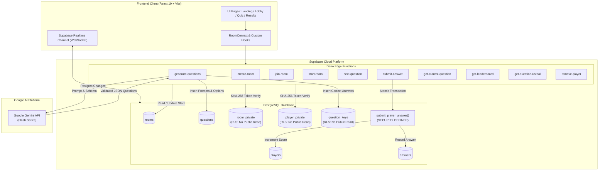
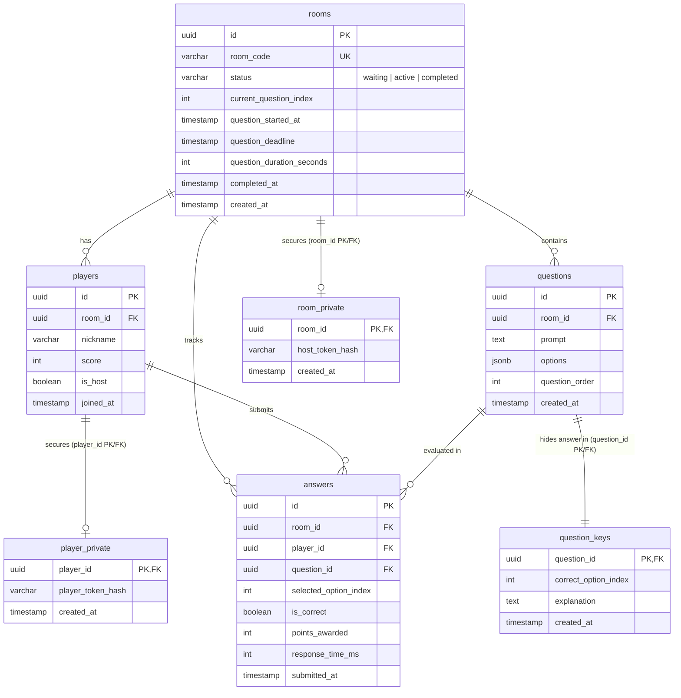

# Quizzr

> **Real-time, AI-powered multiplayer trivia battle built with React 19, Supabase Realtime, and Google Gemini.**

---

## 1. Project Overview

**Quizzr** is an immersive, real-time multiplayer trivia platform that enables hosts to instantly generate custom quizzes on any topic using Google Gemini generative AI and host live competitions across distributed participants.

Featuring synchronized server-authoritative timers, instantaneous answer locks, anti-cheat answer keys isolated at the database layer, and live real-time status updates via Supabase Realtime WebSocket subscriptions, Quizzr transforms static trivia into a synchronized competitive gaming experience.

---

## 2. Problem Statement

Traditional online trivia and classroom quiz systems often suffer from significant friction:
- **Manual Question Preparation**: Quiz creators spend hours writing, formatting, and balancing question difficulty.
- **Client-Side Vulnerabilities & Cheating**: Many platforms send question answers directly to client browsers or expose them in client-side bundles, allowing players to inspect network payloads or DOM state to cheat.
- **Clock Drift & Latency Inequity**: Relying on local client timers introduces desynchronization, allowing players with slower devices or manipulated device clocks to submit late answers.
- **Rigid Scoring Models**: Lack of responsive, dynamic scoring based on speed and question deadline precision.

Quizzr addresses these challenges with **server-authoritative execution**, **zero-exposure private keys**, and **on-demand multi-model AI generation**.

---

## 3. Key Features

- **Instant AI Quiz Generation**: Create 5, 10, or 15 multiple-choice questions on any custom topic and difficulty (Easy, Medium, Hard) within seconds via Google Gemini.
- **Zero-Exposure Anti-Cheat Architecture**: Answer keys and explanations are stored strictly in a private `question_keys` table with Row Level Security (RLS) denying public access. Correct answers are never sent to participant devices during active gameplay.
- **Server-Authoritative Clock Synchronization**: Question durations, start timestamps, and strict deadlines are computed and enforced by Supabase Edge Functions (`nowMs > deadlineMs` rejects late submissions).
- **Fast-Track Question Progression**: As soon as all participants in an active room submit their answers, the game immediately moves to the next question without waiting out the remaining countdown.
- **Dynamic Speed-Based Scoring**: Correct answers award a base score of 100 points plus up to 50 time-bonus points calculated from remaining time over total question duration. Incorrect answers receive zero points:
  $$\text{Points} = \begin{cases} 100 + \text{round}\left(50 \times \dfrac{\text{Remaining Time}}{\text{Total Question Duration}}\right) & \text{if correct} \\ 0 & \text{if incorrect} \end{cases}$$
- **Instantaneous Submission Feedback**: Submitting an answer instantly locks the player's choices and halts their local timer, displaying an active waiting state while other players complete their turns.
- **Atomic Concurrency Protection**: Database-level unique constraint on `(player_id, question_id)` and atomic PostgreSQL stored procedure (`submit_player_answer`) eliminate race conditions and prevent duplicate submissions.
- **Live WebSocket Synchronization**: Automatic room transitions, player arrivals, removals, and game starts stream to all clients through Supabase Realtime channels.
- **Olympic-Style Podium & Standard Competition Ranking**: Visual medal podium (Gold, Silver, Bronze) and complete leaderboard handling ties using standard competition ranking (1224).
- **Celebration Confetti Effects**: Physics-based, zero-dependency upward-launching canvas confetti cannon on quiz completion.

---

## 4. Technology Stack

### Frontend
- **Framework**: [React 19](https://react.dev/) (`^19.3.1`)
- **Build Tool**: [Vite 8](https://vite.dev/) (`^8.3.6`)
- **Styling**: [Tailwind CSS v4](https://tailwindcss.com/) (`^4.3.5`) with `@tailwindcss/vite`
- **Routing**: [React Router v7](https://reactrouter.com/) (`^7.18.5`)
- **Icons**: [Lucide React](https://lucide.dev/) (`^1.73.0`)
- **Linting & Quality**: [Oxlint](https://oxc.rs/) (`^1.90.0`)

### Backend & Cloud Infrastructure
- **BaaS Platform**: [Supabase](https://supabase.com/)
- **Database**: PostgreSQL with Row Level Security (RLS) and PL/pgSQL Stored Procedures
- **Edge Computing**: Deno-based Supabase Edge Functions
- **Realtime**: PostgreSQL CDC (Change Data Capture) via Supabase Realtime WebSocket channels
- **Authentication & Authorization**: Cryptographic SHA-256 token hashing (`host_token_hash`, `player_token_hash`)

### Artificial Intelligence
- **LLM Engine**: Google Gemini API (`gemini-3.5-flash-lite`, `gemini-3.8-flash`, `gemini-4-hydrogen`, `gemini-4-argon`)
- **Execution Mode**: Structured JSON output with explicit thinking levels and exponential backoff retry.

---

## 5. System Architecture



---

## 6. Application Workflow

### 1. Room Creation & Question Generation
1. Host enters a nickname, custom topic, difficulty level, and number of questions (5, 10, or 15).
2. Host clicks **Create & Launch Room**.
3. Frontend invokes `create-room`, generating a unique 6-character room code, initializing room status as `'waiting'`, and creating cryptographic 32-byte tokens (`hostToken`, `playerToken`).
4. Edge Function hashes tokens with SHA-256 and stores hashes in `room_private` (keyed by `room_id`) and `player_private` (keyed by `player_id`).
5. Frontend automatically invokes `generate-questions`.
6. Gemini generates validated multiple choice questions. Prompts and choices are stored in `questions`, while correct indices and explanations are isolated into `question_keys` (keyed by `question_id`).
7. Host is redirected to the **Waiting Room**.

### 2. Participant Join & Lobby
1. Participants navigate to the landing page, select an avatar, enter a nickname, and input the 6-character room code.
2. `join-room` verifies the room status is `'waiting'`, creates a record in `players`, issues a unique `player_token`, and stores its SHA-256 hash in `player_private`.
3. Participants and host listen to `rooms` and `players` table updates via Supabase Realtime.
4. Host has the authority to kick disruptive players using `remove-player`.

### 3. Quiz Execution & Synchronized Gameplay
1. Host clicks **Start Quiz**, triggering `start-room`.
2. The room status transitions from `'waiting'` to `'active'`, setting `current_question_index = 1`, `question_started_at`, and `question_deadline`.
3. All players receive the room update via WebSocket and render **Question 1**.
4. Players select an option and submit before the deadline. `submit-answer` validates the token, checks the deadline, checks for duplicate submissions, computes points (100 base + up to 50 time-bonus), and atomically records the score via `submit_player_answer`.
5. Submitting players see their options immediately locked with an active waiting banner.
6. Once all players have submitted (or when the authoritative deadline passes), the host client triggers `next-question`.
7. Brief 2-second answer reveal displays the correct option and brief explanation fetched via `get-question-reveal`.
8. The server advances `current_question_index` until all questions are completed.

### 4. Final Standings & Results
1. After the final question, `next-question` sets room status to `'completed'`.
2. All clients automatically transition to `FinalResults`.
3. An Olympic-style podium highlights 1st (Gold), 2nd (Silver), and 3rd (Bronze) places, along with the complete tournament ranking.
4. A celebratory upward-launching canvas confetti animation fires for all participants.

---

## 7. Database Tables and Relationships



### Table Security Summary (RLS Policies)
- **`rooms`**: Public `SELECT` allowed for active games; mutations strictly restricted to service role / Edge Functions. Room status values are strictly: `'waiting'`, `'active'`, or `'completed'`.
- **`players`**: Public `SELECT` for room members; mutations restricted to Edge Functions.
- **`questions`**: Public `SELECT` allowed for active question prompts and choices.
- **`question_keys`**: **RLS enabled with ZERO public select policies**. Primary key is `question_id` (foreign key referencing `questions.id`). Accessible exclusively via Supabase `service_role` inside Edge Functions.
- **`room_private` & `player_private`**: **RLS enabled with ZERO public select policies**. Primary keys are `room_id` and `player_id` respectively. Stores SHA-256 hashed credentials.
- **`answers`**: Enforces a unique constraint on `(player_id, question_id)`. Mutations managed atomically via the `submit_player_answer` stored procedure.

---

## 8. AI Question Generation using Gemini

The `generate-questions` Edge Function coordinates with Google Gemini to produce clean, factual trivia questions:

### Active Model Configuration
The fallback chain is explicitly configured in `supabase/functions/generate-questions/index.ts` with dedicated thinking levels:
1. `gemini-3.5-flash-lite` (`thinkingLevel: "MINIMAL"`) - Primary fast-path model
2. `gemini-3.8-flash` (`thinkingLevel: "LOW"`) - High-accuracy fallback
3. `gemini-4-hydrogen` (`thinkingLevel: "LOW"`) - High-throughput fallback
4. `gemini-4-argon` (`thinkingLevel: "LOW"`) - Emergency fallback

### Schema & Parsing Resilience
- Strict structured output requesting an array of objects matching:
  ```json
  [
    {
      "prompt": "Question text?",
      "options": ["Choice 0", "Choice 1", "Choice 2", "Choice 3"],
      "correct_option_index": 0,
      "explanation": "Why choice 0 is correct."
    }
  ]
  ```
- Multipart extraction that safely filters out model thought parts (`p.thought`) before parsing JSON text.
- Retry loop with randomized exponential backoff (800ms - 1200ms) for transient HTTP 503 (high demand) and HTTP 429 (rate limit) status codes.
- Per-request 45-second `AbortController` timeout safeguard.
- Sanitized database storage: Prompts and options are stored in `questions`, while `correct_option_index` and `explanation` are saved to `question_keys` and excluded from host previews.

---

## 9. Real-time Multiplayer Synchronization

### Realtime Channel Subscriptions
Clients connect to a centralized Supabase Realtime channel scoped to their room (`room:<room_code>`):

```javascript
const channel = supabase
  .channel(`room:${roomCode}`)
  .on('postgres_changes', { event: 'UPDATE', schema: 'public', table: 'rooms', filter: `id=eq.${roomId}` }, handleRoomUpdate)
  .on('postgres_changes', { event: '*', schema: 'public', table: 'players', filter: `room_id=eq.${roomId}` }, handlePlayersUpdate)
  .subscribe();
```

### Fast-Track Advancement Logic
- Whenever an answer is recorded, the server checks the count of submitted answers against the total active player count.
- If all active players have submitted, the host client detects consensus and immediately triggers `next-question`.
- If one or more players have not submitted, the question countdown timer continues normally until `question_deadline`.

---

## 10. Security Implementation

1. **Anti-Cheat Answer Key Isolation**:
   - `question_keys` has Row Level Security enabled with no public access policies.
   - Frontend bundles and network inspection tools cannot view correct answers before question expiration.
2. **Cryptographic Token Hashing (Zero Plaintext Secrets)**:
   - When rooms or players are created, 32-byte cryptographically secure random tokens are generated.
   - Only the SHA-256 hex digest is saved in `room_private` (`host_token_hash`) or `player_private` (`player_token_hash`).
   - Incoming Edge Function calls must present the unhashed token, which is hashed in-memory using the Web Crypto API (`crypto.subtle.digest("SHA-256", ...)`) and matched against the hash in the database.
3. **Server-Authoritative Clock**:
   - Scores and validity are computed using PostgreSQL server timestamps (`clock_timestamp()`) and Edge Function server times, defeating client-side system clock manipulation.
4. **Concurrency & Race Condition Defenses**:
   - Unique database constraint on `(player_id, question_id)` in `answers`.
   - Atomic scoring transaction wrapped in `submit_player_answer` executing with `SECURITY DEFINER` access.

---

## 11. Installation and Local Setup

### Prerequisites
- [Node.js](https://nodejs.org/) (v18 or higher)
- [Supabase CLI](https://supabase.com/docs/guides/cli)
- Google Gemini API Key

### 1. Clone the Repository
```bash
git clone https://github.com/umangbaliyan/Quizzr.git
cd Quizzr
```

### 2. Install Frontend Dependencies
```bash
npm install
```

### 3. Configure Local Environment
Create a `.env.local` file in the root directory:
```env
VITE_SUPABASE_URL=https://your-project-ref.supabase.co
VITE_SUPABASE_PUBLISHABLE_KEY=your-supabase-anon-key
```

### 4. Supabase Setup & Edge Function Deployment
Link your remote Supabase project:
```bash
npx supabase link --project-ref your-project-ref
```

Apply database migrations:
```bash
npx supabase db push
```

Set server secrets for Edge Functions:
```bash
npx supabase secrets set GEMINI_API_KEY=your-gemini-api-key
```

Deploy Edge Functions:
```bash
npx supabase functions deploy --no-verify-jwt
```

### 5. Run Development Server
```bash
npm run dev
```

The application will be running locally at `http://localhost:5173`.

### 6. Production Build & Linting
```bash
# Verify static analysis with Oxlint
npm run lint

# Compile production bundle
npm run build

# Preview production build locally
npm run preview
```

---

## 12. Environment Variables

### Client-Side (`.env.local`)
| Variable Name | Description |
|---|---|
| `VITE_SUPABASE_URL` | The HTTPS URL endpoint for your Supabase project. |
| `VITE_SUPABASE_PUBLISHABLE_KEY` | The public Supabase anonymous (`anon`) API key. |

### Supabase Edge Function Secrets (`supabase secrets set`)
| Variable Name | Description |
|---|---|
| `GEMINI_API_KEY` | Google Gemini API key used to generate questions. |
| `SUPABASE_URL` | Injected automatically by the Supabase Edge runtime. |
| `SUPABASE_SERVICE_ROLE_KEY` | Injected automatically by the Supabase Edge runtime to bypass RLS in secure server functions. |

---

## 13. Screenshots & Visual Previews

<!-- Screenshots can be added here -->

### Landing Page & Game Lobby
> *Screenshot placeholder: Landing page featuring instant AI quiz creation, difficulty selector, and room code entry.*

### Real-time Multiplayer Waiting Room
> *Screenshot placeholder: Waiting room displaying connected player roster and host controls.*

### Active Trivia Question & Answer Selection
> *Screenshot placeholder: Question card with four choices, synchronized countdown timer, and answer lock status.*

### Olympic-Style Podium & Final Standings
> *Screenshot placeholder: Olympic medal podium (Gold, Silver, Bronze) with complete competition rankings and confetti celebration.*

---

## 14. Future Scope

The following features represent architectural extensions planned for upcoming iterations:

- **Audio & Sound Effects**: Ambient background electronic audio, countdown ticks, and victory sound bites.
- **Custom Question Packs & Manual Authoring**: Ability for educators and hosts to write manual questions alongside AI-generated ones.
- **Player Spectator Mode**: Allow latecomers to stream active quizzes in read-only spectator mode.
- **Post-Game PDF Analytics**: Detailed accuracy reports exported as downloadable summaries for classroom and corporate training.
- **Persistent Player Profiles & Global Stats**: Optional player account creation with cross-game XP, win streaks, and achievement badges.
